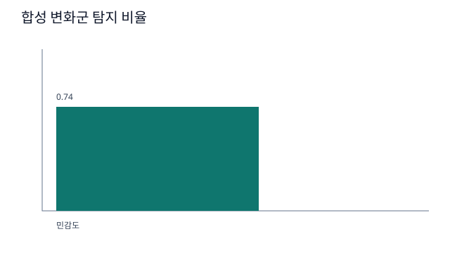
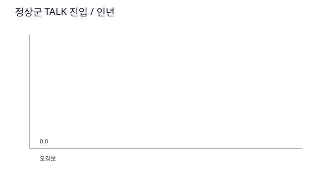
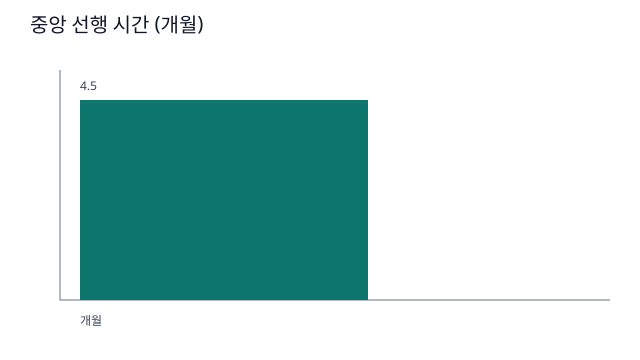
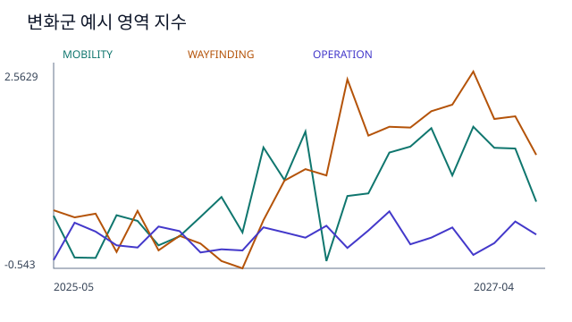

# 핸들온 (HandleOn)

**운전 습관의 작은 변화를 '평소의 나'와 견주어 살피고, 가족과 이야기 나눌 때를 알려 주는 Pleos Connect 차량 앱.**

> 핸들온은 의료기기가 아니며, 운전 습관의 변화를 알려 드릴 뿐 건강 상태를 판단하지 않습니다.

- 차가 1초마다 보내는 신호(속도·기어·조향·방향지시등·와이퍼·위치·내비 안내)로 트립마다 지표를 만들고, 자체 엔진 **드라이브프린트(Driveprint)** 가 본인 기준선과 견줘 달라진 점을 찾습니다.
- **마음 운전**(60세 이상): 몇 달에 걸친 생활 반경·길찾기·조작 변화를 보고, 대화가 필요해 보이면 가까운 치매안심센터와 순정 내비 길안내를 보여 줍니다.
- **운전 컨디션**(20~50대): 하루·한 주 단위로 피로처럼 짧은 변화를 봅니다.
- **휴대폰 앱**: 운전자가 받는 사람마다 공유 범위(단계만 / 추이 그래프까지 / 자세한 지표와 편지까지), 시점(바로 / 3·7·14일 뒤), 운전 패턴 공유 여부를 직접 골라 가족과 나눕니다. 기본값은 없습니다. 월간 운전 편지와 푸시 알림이 있습니다.
- **공유는 운전자가 쥡니다**: 휴대폰이나 차 화면에서 한 번에 공유를 잠시 멈추거나 모두 끊을 수 있고, "가족이 보는 화면"으로 가족에게 지금 무엇이 보이는지 그대로 봅니다. 운전 기록은 보험사·면허 기관·광고·데이터 판매에 넘기지 않습니다.
- **운전 패턴(집계)**: 월별 운전 횟수·시간·운전한 날, 밤·30km 넘는 운전 비율, 다니는 범위·가는 곳 가짓수를 본인 기준과 견준 비율로만 나눕니다. 장소 이름·좌표는 보내지 않습니다.
- **주차한 뒤에만 보이는 카드**: 가족이 보낸 한마디, 보건복지부 치매예방수칙 3·3·3을 챙기도록 돕는 "오늘의 한 줄", 오래 운전한 뒤의 쉬어 가기(커피 + 15분 안쪽 낮잠 타이머). 주행 중에는 2시간 넘게 이어 운전하면 정적인 쉬어 가기 문구 한 줄만 보입니다.
- **원본 위치는 차 밖으로 나가지 않습니다.** 서버에는 운전 기록으로 월·일 집계와 단계(그리고 월간 편지)만 저장합니다. 예외는 운전자가 휴대폰에서 구글 타임라인 내보내기 파일로 지난 운전 기록을 가져올 때입니다. 휴대폰이 차로 이동한 구간의 출발·도착 시각과 위치, 거리만 뽑아 올리고, 차가 받는 즉시 서버에서 지웁니다.

## APK

| 파일 | 내용 |
|---|---|
| [`apk/HandleOn_핸들온_release.apk`](apk/HandleOn_핸들온_release.apk) | **차량 앱** release 빌드(서명됨). Pleos Connect Emulator 2.1.0 에서 확인 |
| [`apk/HandleOn_핸들온_휴대폰_release.apk`](apk/HandleOn_핸들온_휴대폰_release.apk) | **휴대폰 앱**(운전자·가족 공용) release 빌드(서명됨, 64비트 ARM 휴대폰·x86_64 에뮬레이터). Android 15 에뮬레이터에서 확인 |

## 저장소 구성

| 폴더 | 내용 |
|---|---|
| `car/app` | Pleos 차량 앱 (Kotlin, Jetpack Compose) |
| `car/driveprint` | 드라이브프린트 엔진 (순수 Kotlin/JVM) |
| `car/sim` | 합성 코호트 시뮬레이터와 재생 모드용 가상 인물 생성기 |
| `server` | Supabase (Postgres 마이그레이션, Edge Functions, 시험) — [server/README.md](server/README.md) |
| `phone` | 휴대폰 앱 (Flutter, 운전자·가족 공용) — [phone/README.md](phone/README.md) |
| `tools` | 에뮬레이터 주행 재현(`drive.sh`), 센터 자료 생성(`centers_csv.py`) |
| `docs/sim` | 시뮬레이터 결과 그림 |
| `licenses` | 글꼴 라이선스, 공공데이터 출처 |

## 실행 방법

### 1. APK 로 바로 보기 (Pleos Connect Emulator)

1. Pleos Playground 안내대로 Android Studio 와 Pleos Connect Emulator 2.1.0 (x86_64) 을 설치하고 켭니다.
2. 앱을 설치합니다.
   ```
   adb install apk/HandleOn_핸들온_release.apk
   ```
3. 앱 목록에서 **핸들온**을 열고 첫 실행 화면에서 태어난 해를 넣고(60세 이상이면 '마음 운전'이 미리 골라집니다) 동의 세 개를 체크한 뒤 위치·차량 정보 권한을 허용합니다. 이어서 나오는 위치 권한 화면에서 **'항상 허용'** 을 고르면 앱을 열지 않아도 시동 직후부터 모읍니다(설정 → "시동 직후부터 모으기"에서 나중에 켤 수도 있습니다). 고르지 않으면 앱을 연 뒤부터 모읍니다.
4. **24개월을 60초로 보기**: 설정 → "24개월을 60초로 보기" → 재생. 가상 인물(아버지)의 운전이 안정 → 관찰 → 대화 권유로 바뀌는 과정을 엔진이 실제로 계산해 보여 줍니다. 마지막 달의 **가까운 곳 보기 → 길안내** 로 순정 내비가 경로를 잡습니다.
5. **실제 주행**: 에뮬레이터 Virtual Console(`http://127.0.0.1:8088`, `adb forward tcp:8088 tcp:8088`)에서 기어를 D 로 두고 달린 뒤 P 로 세우면 트립이 저장되고 리포트가 갱신됩니다. 같은 일을 `tools/drive.sh 150` 이 자동으로 합니다. 달리는 동안 앱은 주행 화면("핸들온이 함께하고 있어요")으로 바뀝니다.
6. **발표 모드의 쉬어 가기**: 발표 모드에서는 쉬어 가기 기준을 2시간에서 2분으로 줄입니다. `tools/drive.sh 150` 으로 달리면 주행 화면에 쉬어 가기 문구가, 세운 뒤 홈에 쉬어 가기 카드와 15분 타이머가 나옵니다.
7. **발표 모드 엔진 화면**: 설정 → 발표 모드 켜기 → 엔진 화면 열기. Pleos 신호가 들어오는 대로 이번 트립의 지표가 2초마다 다시 계산되는 모습을 보여 줍니다(시연용).

### 2. 소스에서 빌드

차량 앱·엔진·시뮬레이터 (JDK 21):

```
cd car
./gradlew :driveprint:test :sim:test :app:testDebugUnitTest   # 엔진·시뮬레이터·앱 단위 시험
./gradlew :sim:run                                              # 합성 코호트 시뮬레이터(결과: car/sim/build/sim/)
./gradlew :app:assembleRelease                                  # release APK
```

의존성은 Google Maven, Maven Central, Pleos Playground Nexus(`car/settings.gradle.kts`)에서 받습니다. 루트 빌드 파일이 Android Gradle Plugin 을 선언하므로 엔진 시험만 돌릴 때도 Google Maven 에 접속할 수 있어야 합니다.

`car/local.properties`(저장소에 없음)에 서버 설정을 넣으면 휴대폰 연결·월간 편지가 켜집니다. 없으면 차 안 기능만 동작합니다.

```
SUPABASE_URL=https://<프로젝트>.supabase.co
SUPABASE_ANON_KEY=<공개 anon 키>
```

release 서명은 `car/keystore.properties`(저장소에 없음, `storeFile`·`storePassword`·`keyAlias`·`keyPassword`)를 읽습니다. 없으면 서명 없이 빌드됩니다.

휴대폰 앱과 서버는 각 폴더의 README 를 봐 주세요.

## 테스트 환경

| 항목 | 버전 |
|---|---|
| 차량 에뮬레이터 | Pleos Connect Emulator 2.1.0 (Android 14, x86_64) |
| Pleos SDK | Vehicle 2.3.2, NaviHelper 3.0.5 |
| 빌드 | Android Studio Rabbit 1, JDK 21, Gradle 8.10.2, AGP 8.8.2, Kotlin 2.0.0, compileSdk 35 / minSdk 28 |
| 휴대폰 앱 | Flutter 3.47.7 — iOS 26.3 시뮬레이터(iPhone 17 Pro), Android 15 에뮬레이터(API 35) |
| 서버 | Supabase (Postgres, Edge Functions/Deno, pg_cron), Firebase Cloud Messaging |

## 필요한 설정

- **APK 에는 시연용 개발 서버의 주소와 공개(anon) 키가 들어 있습니다.** 따로 설정하지 않아도 휴대폰 연결과 월간 편지가 동작합니다. 서버에 연결하지 않아도 수집·엔진·화면·재생·센터 안내는 모두 차 안에서 동작합니다.
- 휴대폰 연결을 시연하려면 휴대폰 앱이 필요합니다. `adb install apk/HandleOn_핸들온_휴대폰_release.apk` 로 휴대폰(또는 휴대폰 에뮬레이터)에 설치하고, 운전자로 가입·로그인한 뒤 차 화면 설정 → 휴대폰 연결에 나오는 QR·6자리 코드를 넣습니다. 가족은 운전자가 만든 초대 코드로 가입합니다. 가입할 때 이메일 확인이 필요할 수 있습니다.
- 생활 반경 지표(집에서 거리)는 순정 내비 즐겨찾기의 '집'을 씁니다. 등록하지 않으면 그 지표만 빠지고 나머지는 동작합니다.
- 권한: 위치(시동 직후부터 모으려면 '항상 허용'), 차량 속도·기어(`android.car.permission.CAR_SPEED`, `CAR_POWERTRAIN`), Pleos 차량·내비 권한(매니페스트 참조). App Market 승인이 필요한 권한은 승인을 전제로 합니다.

## 드라이브프린트 엔진

- **지표 15개**: 생활 반경 7(트립 수, 운전한 날, 8~16km 나들이, 야간 비율, 목적지 수, 목적지 다양성, 집에서 거리), 길찾기 3(좌회전 비중, 익숙한 길 재탐색, 익숙한 곳 길안내), 조작 5(과속 비율, 급제동, 직진 핸들 흔들림, 방향지시등 누락, 차로 유지 보조 개입).
- **근거 등급**: A·B 는 공개 연구(미국 DRIVES·LongROAD 코호트 등)에서 보고된 지표(영역 지수 가중치 A 1.0, B 0.6), C(익숙한 길 재탐색·길안내, 방향지시등 누락, 차로 유지 보조)는 Pleos 의 내비·차량 신호로 처음 측정할 수 있는 가설 지표로 가중치를 낮게(0.3) 둡니다.
- **본인 기준선**: 운전자마다 기준 기간의 중앙값·MAD 로 수정 z 를 내고, 영역별 지수의 개인 임계값(기준 기간 95백분위, 최소 1.5)을 씁니다. 본인이 라벨(잠 설침·감기·새 약·여행)을 붙인 날은 판단에서 빼고, 밤이나 비 오는 날의 운전 컨디션은 '판단 보류'로 둡니다. 집·차가 바뀌면 기준선을 다시 쌓습니다.
- **대화 권유 규칙**: 가장 최근에 끝난 달에 2개 이상 영역이 개인 임계값을 넘고, 그중 하나 이상이 그 앞에 평가된 달에도 넘었을 때. 한 영역이라도 넘으면 '관찰', 넘은 영역이 없으면 '안정'입니다.

## 합성 코호트 시뮬레이터 결과 — 임상 검증이 아니라 엔진 동작 검증

가상 운전자 200명(정상군 100, 변화군 100) × 30개월을 만들어 엔진을 그대로 돌린 결과입니다(`./gradlew :sim:run`, 시드 7). 실행하면 `car/sim/build/sim/` 에 `summary.json` 과 아래 그림이 생깁니다.

| 탐지 비율 | 정상군 오경보 | 중앙 선행 시간 |
|---|---|---|
|  |  |  |

- 민감도 **0.74**, 정상군 대화 권유 **0회/인년**, 중앙 선행 **4.5개월**, 정상군에서 '관찰' 단계가 나온 달 0.7%.
- **가정값**: 변화 시작 10~16번째 달, 6개월에 걸쳐 직선 변화 — 트립 ×0.75, 장소 수 ×0.7, 집에서 거리 ×0.7, 야간 ×0.5, 익숙한 길 재탐색 ×2, 익숙한 곳 길안내 0.05→0.25, 방향지시등 누락 0.10→0.20, 좌회전 비중 0.45→0.38. 교란: 겨울 트립 ×0.85, 명절 장거리, 연 1~2회 감기 주간(트립 ×0.5), 장마철 비. 선행 시간 기준점은 '변화 시작 + 12개월'로 가정했으며 실제 임상 전환 시점이 아닙니다.
- 변화의 크기는 연구의 방향을 따른 **가정값**이라 실제 사람에서의 성능을 뜻하지 않습니다. 국내 실주행 검증은 공모전 이후 과제입니다.



## 데이터와 라이선스

- 치매안심센터 목록: 공공데이터포털 '전국치매센터표준데이터' — 출처·기준일·가공 방법은 [licenses/centers-data.md](licenses/centers-data.md).
- 글꼴: Asta Sans (42dot, SIL Open Font License) — [licenses/AstaSans-OFL.txt](licenses/AstaSans-OFL.txt).
- '지난 기록'의 블루링크 월별 거리는 **모의 데이터**입니다. 블루링크 연동은 현대자동차그룹 제휴·승인 후 제공하는 것을 전제로 합니다.
- 재생 모드의 아버지·자녀 운전 기록은 시뮬레이터가 만든 **가상 인물 데이터**입니다.
